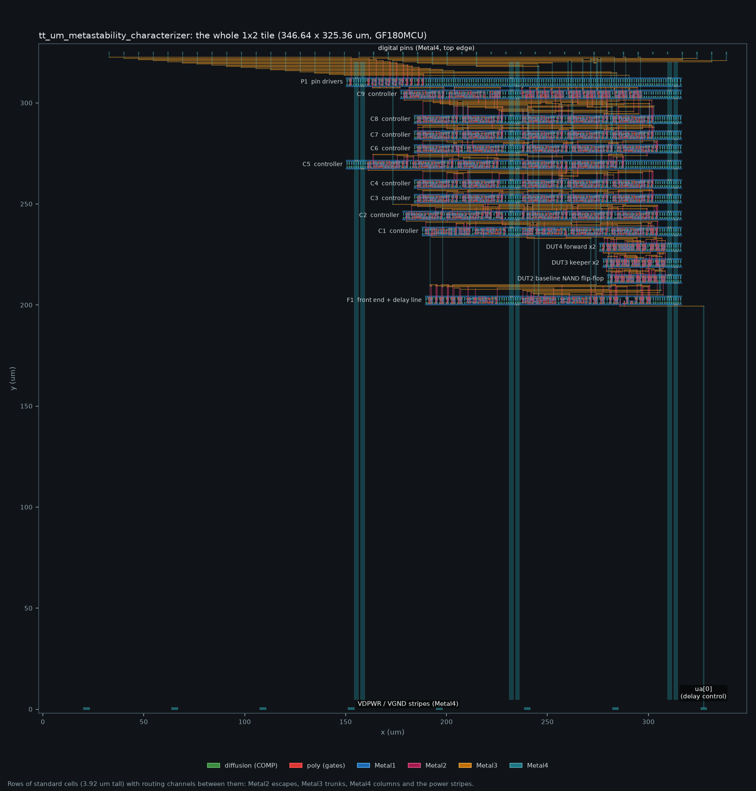

# Metastability characterizer: schematics, layout and checks (GF180, analog 1x2 tile)

**Tiny Tapeout verification record.** What is submitted is `gds/`, `lef/`, `src/project.v`, `info.yaml` and
`docs/info.md`. This file, `tools/`, `layout/` and `verification/` show how that layout was generated and checked.

This folder adds the transistor-level design, the tile layout and the sign-off results. Everything in
`xschem/` and the two netlists in `layout/` are generated from one master netlist: the controller
(`src/gf180/compact_control.v`, 93 cells), plus the four flip-flops under test, the selector, the delay
line and the pin drivers.

**The controller was replaced on 11 November 2026 and the tile was laid out again on 17 November 2026.**
The schematics, the netlists, the layout and the logs in `verification/` all hold `compact_control`.

| Folder | What it holds |
|---|---|
| `xschem/` | Xschem hierarchy: `chip.sch` → `blocks/` → `cells_tx/` (every standard cell drawn with its transistors). `blocks/controller.sch` holds the controller as eight blocks, in the order of the design note in `compact_control.v`: `trial_clock`, `start`, `readings`, `count_pulse`, `trial_counter`, `event_counter`, `status`, `readout`. `focus/` holds the 15 presentation sheets (G01–G04 gate level, F01–F11 transistor level); `flat/` holds each block opened to transistors. `benches/` holds the simulation benches, and `run_benches.sh` runs them. |
| `docs/schematics/` | SVG exports of the 15 presentation sheets (from Xschem, exported again on 17 Nov 2026). |
| `gds/`, `lef/` | The tile as Tiny Tapeout takes it, in the folders of its analog template: `tt_um_metastability_characterizer.gds` and its abstract `tt_um_metastability_characterizer.lef`. The black box with the port list is `src/project.v`. |
| `layout/` | The same layout as Magic files in `mag/`, pictures of it in `renders/`, the LVS reference netlist and the pre-layout simulation netlist (`chip_lvs.spice`, `chip_sim.spice`), and the scripts that run the checks (`run_layout.sh`, `run_postlayout.sh`, `magic_checks.tcl`, `make_tb_chip.py`, `make_tb_tau.py`). |
| `verification/layout/` | Logs of the checks on this layout, 17 Nov 2026: KLayout GF180 rule deck (0 items), KLayout antenna (0 items), Magic DRC (0), Netgen LVS ("Circuits match uniquely"), the Tiny Tapeout precheck (12 of 12 checks), the whole-tile simulation before and after layout, and the post-layout tables. See "The layout and its checks". |
| `verification/sims/` | The 7 bench netlists, their ngspice logs, and `results.txt` (e.g. tau 88.9 ps baseline, 80.5 ps keeper x2, 102.3 ps forward x2), with `expected.json`. Run of 17 Nov 2026 by `xschem/run_benches.sh`: see "Running the benches". |
| `netlist/` | `controller_synth.v`: the controller as a flat cell list, written from the Verilog by `tools/controller_netlist.py`. `chip.cdl`: the master netlist of the whole tile, written by `tools/build_master.py`. |
| `tools/` | The Python generators that produced the netlist, schematics, layout and checks. They run from this repository; see "Regenerating" below. `kit2_gen.py`, which packed the earlier kits for ecetesla0, still points at the original build folder. |

## Using the schematics
On ecetesla0: `cd xschem && bash setup.sh` once (it writes this folder's path into the `.sch`/`.sym` files),
then `bash view.sh F04` opens a sheet full screen with its net colours, and `bash export_svg.sh` writes SVGs.

On Windows, or anywhere without bash: `python xschem/setup.py <pdk_dir>` does the same, and also points the
sheets at your copy of the PDK (`<pdk_dir>` is the folder that holds `libs.tech/`). The sheets need the
PDK's Xschem symbols (`libs.tech/xschem/symbols/nfet_06v0.sym`, `pfet_06v0.sym`) and, for simulation, its
ngspice models (`libs.tech/ngspice/`).

Both write the machine's own paths into the sheets git tracks, and that must not be committed. In a checkout
you commit from, write a copy instead and open the sheets there (`build/` is ignored by git):

    python3 xschem/setup.py --to build/xschem <pdk_dir>
    bash build/xschem/view.sh F04

`docs/schematics/` holds the 15 focus sheets as `bash build/xschem/export_svg.sh` writes them. That script
needs a display; where there is none, run it under `xvfb-run`. (With Xschem's own no-display option, `-x`,
the caption at the bottom of a sheet can fall outside the picture.)

## Running the benches
    bash xschem/run_benches.sh                # 5 min; RECORD=1 also copies the netlists and logs to verification/sims

It writes such a copy into its results folder, netlists the seven benches in `xschem/benches/` from it with
Xschem, and runs them in ngspice. It needs xschem and ngspice, with `PDK_ROOT` set to the folder that holds
`gf180mcuD`. Expected values are on each sheet and in `benches/expected.json`.

Run of 17 Nov 2026, with the open_pdks build e8daeda7: `tb_inv_balance`, `tb_selector`, `tb_duts`, `tb_tau`,
`tb_delay` and `tb_frontend` give the values of 7 Nov 2026 on ecetesla0 to every printed digit, with the
timing capacitor now named `nfet_05v0` (see "Still open"). `tb_controller` gives the values in the next section.

## Checking the controller schematic against the Verilog
Open `xschem/blocks/controller.sch` in Xschem and press Netlist, then:

    python3 tools/check_controller_netlist.py <netlist folder>/controller.spice

It opens both the Xschem netlist and `compact_control.v` down to single transistors and compares them:
93 cells, 1,388 transistors, every net. It needs `pdk_cells/` (below).

The eight flat sheets `xschem/flat/ctrl_<block>.sch` (one controller block each, every transistor on one
page) have their own check: netlist them into one folder, then `python3 tools/check_controller_flats.py
<netlist folder>`.

`xschem/benches/tb_controller.sch` runs the controller at transistor level through reset, START and the
first eight counted trials (2.5 us). A whole block is 65,535 trials, 13.1 ms, which is too long for a
transistor-level run. Expected values are on the sheet and in `benches/expected.json`.

First run of that bench, 11 Nov 2026 (ngspice, typical corner, 3.3 V, 27 C, schematic only: no wiring
capacitance; upstream GF180 model files, not the open_pdks build):

| Measured | Value |
|---|---|
| events counted after 8 trials; busy, done, fault | 8; 3.3 V, 0 V, 0 V |
| first capture edge | 175.2 ns |
| first count at `uo_out[0]` | 926.9 ns |
| `allow_count` settles after `b` falls | 0.85 ns; `tick_n` stays at 3.23 V, no pulse |
| `b` rising to `tick_n` falling | 0.17 ns |
| count pulse width | 99.8 ns |
| one counter stage (clock pin to output) | 0.6 ns falling, 0.9 ns rising |
| 17 stages in a row, worst case | about 15 ns of the 100 ns before `b` falls |
| `run` edge, 10 % to 90 % (it drives 37 pins) | 3.3 ns |

Repeated on 17 Nov 2026 with the open_pdks build e8daeda7 (`verification/sims/tb_controller.log`): 8 events,
busy high, done and fault low, first capture at 175.2 ns and first count at 926.9 ns, as above. The bench
prints those; the other rows were read from its waveforms. The whole-tile bench measures them on the
schematic netlist with the same PDK build and gives the same values (the schematic columns of the controller
table in `verification/layout/results_postlayout.md`).

The same measurements on the whole tile, on the extracted layout and at the slow and fast corners, are under
"After layout" below.

## Regenerating
    git clone --depth 1 https://github.com/google/globalfoundries-pdk-libs-gf180mcu_fd_sc_mcu7t5v0 <lib>
    python3 tools/pdk_cells.py <lib>          # pdk_cells/: the library's cell netlists (not committed)
    python3 tools/controller_netlist.py       # netlist/controller_synth.v from the Verilog (needs yosys)
    python3 tools/build_master.py             # netlist/chip.cdl
    python3 tools/chip_netlists.py            # layout/chip_lvs.spice, layout/chip_sim.spice
    python3 tools/xschem_gen.py <out>         # cells_tx/, blocks/, chip.sch
With these inputs the generator reproduces every sheet that does not involve the controller byte for byte.

Two checks read the sheets back and compare them with `netlist/chip.cdl`, down to single transistors:

    python3 tools/sch_check.py xschem         # the whole hierarchy from chip.sch: SAME CIRCUIT
    python3 tools/check_focus.py              # the 15 focus sheets: ALL SAME

The layout generators read three things kept outside the repository:

    export GF180_SC_CELLS=<lib>/cells         # the same checkout as above: its cell LEF and GDS files
    export TT_ANALOG_DEF=<tt-support-tools>/tech/gf180mcuD/def/analog/tt_analog_1x2.def
    export GF180_MAGIC_TECH=$PDK_ROOT/gf180mcuD/libs.tech/magic/gf180mcuD.tech
    python3 tools/chip_gds.py                 # gds/*.gds, lef/*.lef, layout/layout_plan.json
    python3 tools/drc_lite.py                 # layout/drc_lite_report.json: the generator's own rule, short, open and antenna checks
    python3 tools/precheck_lite.py            # the Tiny Tapeout precheck's file checks
    python3 tools/render_layout.py            # layout/renders/*.png (needs matplotlib)

The GDS writer stamps the time into the file, so a regenerated GDS differs in those bytes and in nothing else.

## The layout and its checks
The tile is generated, not drawn. `tools/layout_gen.py` places the 149 cells in 14 rows: the front end with
the delay line, one row for each NAND flip-flop, nine controller rows, and the pin drivers under the pins.
`tools/route_gen.py` routes them in the channels between the rows: Metal2 up from each pin, Metal3 along
the channel, Metal4 between channels and to the tile pins (175 nets, 11.6 mm of wire, 95 Metal3 tracks,
45 Metal4 columns between channels). `tools/chip_gds.py` writes the GDS, the LEF and `layout_plan.json`. The
cells take x = 150 to 316 um and y = 199 to 324 um of the 346.64 x 325.36 um tile; the rest is empty.

`layout/renders/` has this picture and four close-ups with the cells named, drawn by `tools/render_layout.py`:
the front-end row (`frontend_row.png`), the delay line with the four transistors of its current-starved
stage marked (`delay_line.png`), the baseline NAND flip-flop (`dut_row.png`) and the start of the first
controller row (`controller_row.png`).

To open it in Magic or in KLayout:

    magic -rcfile $PDK_ROOT/gf180mcuD/libs.tech/magic/gf180mcuD.magicrc layout/mag/tt_um_metastability_characterizer.mag
    klayout gds/tt_um_metastability_characterizer.gds -l $PDK_ROOT/gf180mcuD/libs.tech/klayout/tech/gf180mcu.lyp

`layout/klayout_shots.py` saves the KLayout views of the same regions as pictures (the command is at the top
of that file). `layout/mag/` is a copy of the GDS, written by `layout/gds2mag.tcl` (the command is at the top of that file).
Loaded from those files the tile has no Magic DRC errors and matches the netlist as well. The GDS is the
layout that is checked and submitted: if the tile is edited in Magic and written back to GDS, run every
check again on that GDS.

    RECORD=1 bash layout/run_layout.sh        # 20 min: rule decks, Magic DRC, extraction, LVS, simulation before and after layout
    RECORD=1 bash layout/run_postlayout.sh    # an hour: corners, d, arrival, events and tau on the extracted netlist

Both need klayout, magic, netgen and ngspice, with `PDK_ROOT` set to the folder that holds `gf180mcuD`. They
write to `build/layout/`, and `RECORD=1` copies the logs to `verification/layout/`.

Run of 17 Nov 2026: WSL Ubuntu 24.04, Magic 8.3.703, Netgen 1.5.325, KLayout 0.30.12, ngspice 42, and the
open_pdks build e8daeda7, which is the build the Tiny Tapeout precheck installs.

| Check | Result | In `verification/layout/` |
|---|---|---|
| KLayout GF180 rule deck, all rules but density | 0 violations | `drc_klayout.log`, `klayout_drc_main.lyrdb` |
| KLayout antenna deck | 0 violations | `drc_antenna.log`, `klayout_antenna.lyrdb` |
| Magic DRC, full style | 0 errors | `drc_magic.txt` |
| Netgen LVS against `layout/chip_lvs.spice` | Circuits match uniquely | `lvs_report.txt`, `lvs.log` |
| Tiny Tapeout precheck, tt-support-tools 8f7b506 | 12 of 12 checks pass | `tt_precheck.md` |
| Whole tile before and after layout: reset, START, four count pulses | busy high, done and fault low, no events, in both | `tb_chip_pre.log`, `tb_chip_post.log` |
| The generator's own checks | no rule violation, short or open; worst antenna ratio 188 of 400 | `layout/drc_lite_report.json` |

The precheck was run on this machine, on `gds/` and `lef/` as they are here. The LEF marks the analog pins
`USE SIGNAL`, as Tiny Tapeout requires. The run on GitHub is still to come (see "Still open").

### After layout
Magic extracts the capacitance of every wire, to the substrate and to the wires beside it: 0.87 pF on the
signal nets. Wire resistance is not extracted. At the PDK's 0.09 ohm per square and 4.5 ohm per via it comes
to about 100 ohm across the longest net, `run` (0.9 mm of wire, 119 fF), which is worth some 10 ps, and to
1 or 2 ps on the capture and early-sample clocks.

`verification/layout/results_postlayout.md` has every table: *d* against `ua[0]`, the arrival of each
flip-flop's new value, tau, and the controller at four corners. At the typical corner, 3.3 V, 27 C:

| | Schematic | Layout |
|---|---|---|
| *d*, capture edge to early-sample clock, `ua[0]` = 1.8 V | 1.10 ns | 1.72 ns |
| *d* over `ua[0]` = 3.3 V to 1.0 V | 0.80 to 2.93 ns | 1.31 to 4.19 ns |
| new value at the early observer, DUT1 | 1.25 ns | 2.26 ns rising, 2.37 ns falling |
| new value at the early observer, DUT2 to DUT4 | 0.96 to 0.97 ns rising, 1.15 to 1.17 ns falling | 1.69 to 1.82 ns rising, 1.94 to 2.13 ns falling |
| tau: DUT2, DUT3, DUT4 | 88.8, 80.6, 102.0 ps | 136.1, 113.8, 163.1 ps |
| wiring on each latch node `mq`, `mqb` | 0.25 fF, an estimate | 2.4 to 2.7 fF |
| `run` edge, 10 % to 90 % | 3.3 ns | 9.5 ns |
| one counter stage, output rising | 0.87 ns | 1.77 ns |
| last count settled after `b` rises | 15 ns | 31 ns |

What the layout changes:

- **tau is 41 to 60 % longer.** Every net, however short, goes up to a Metal3 track in a channel, so each
  latch node carries about 2.5 fF of wire where the schematic assumed 0.25 fF. The order of the three NAND
  flip-flops is the same and they are further apart: keeper doubled is 0.84 of the baseline (schematic
  0.91), forward gate doubled 1.20 (schematic 1.15).
- **The measurement window moves to lower `ua[0]`.** *d* is longer at every setting, and the flip-flop's
  new value takes longer still to reach the early observer. An early sample taken before it arrives reads
  the old value, and every trial in which the data changed then counts: with `ua[0]` = 3.3 V, 4 events in
  4 counted trials, on the schematic and on the layout. The sample also needs the early observer's setup
  time after the arrival. At the typical corner 0.54 ns was enough (`ua[0]` = 1.3 V, DUT2, no events). At
  slow 3.0 V 125 C 0.62 ns was not: of the eight counted trials, the four in which the value fell were
  events, and the four in which it rose, 1.19 ns ahead of the sample, were not. At `ua[0]` = 1.1 V there,
  2.2 ns ahead, none was. So after layout the useful settings are `ua[0]` of about 1.3 V and below at the
  typical corner. `docs/info.md` now has the post-layout table.
- **The monitor pins read less than *d*.** The delay from `uio_out[4]` to `uio_out[5]` is 0.08 to 0.12 ns
  shorter than *d* at the typical corner (0.05 ns on the schematic), and 0.05 to 0.22 ns over the corners.
- **The controller keeps its margins at all four corners**, typical, slow 3.0 V at -40 C and 125 C, and fast
  3.6 V at -40 C. For the four points the design note in `compact_control.v` leaves to SPICE:
  - The last count settles 18 to 60 ns after `b` rises, of the 100 ns before `done` and `allow_count`
    sample it.
  - `allow_count` rises 0.9 to 3.0 ns after `b` falls, and `tick_n` stays within 50 mV of the supply until
    the first count.
  - `run` is the slowest wire, 5.9 to 17.3 ns from 10 % to 90 %. Nothing reads it for 150 ns after it
    changes, and the flip-flops it releases get their first clock 250 ns after, so it needs no buffer.
  - Counter switching is over before the next capture, 50 ns after `b` rises, except at slow 3.0 V 125 C
    for the longest ripples: with every stage at its slower edge, one that reaches `n[14]` or further takes
    53 to 60 ns there. That is 3 of the 65,535 counted trials in a block (after counts 16,383, 32,767 and
    49,151).

  In every run busy is high, done and fault are low, and the count pulse is 99.3 to 99.9 ns wide.

`layout/make_tb_chip.py` finds the nets it measures from the cells around them, so the same bench runs on
both netlists. `layout/make_tb_tau.py` measures tau the way `xschem/benches/tb_tau.sch` does; on the
schematic with the sheets' wiring estimates it gives 88.8, 80.6 and 102.0 ps where that bench gave 88.9,
80.5 and 102.3 ps. On the extracted netlist it takes the nine cells of each flip-flop with every wiring
capacitor on their nets, and ties the far end of a capacitor to another net to ground.

## Still open
- **LVS on ecetesla0.** The delay line's timing capacitor `MCT` is `nfet_05v0` in the netlist since
  17 Nov 2026. That is what Magic extracts with the open_pdks builds e8daeda7 and 5740c4a8, because the
  device lies under the cell's 5 V marker. With the PDK on ecetesla0 on 7 Nov 2026 Magic called it
  `nfet_06v0`, and the netlist said so until now. Both names are the same model card with the same
  parameters, so no simulation changes. If the checks are run on ecetesla0 before its PDK is updated, LVS
  will report that one device.
- **The precheck on GitHub.** The template's workflows are in `.github/workflows`. Their run on this layout
  is still to come: so far the precheck was run locally.
- **Wiring on the latch nodes.** If tau nearer the schematic's is wanted, `mq` and `mqb` of each NAND
  flip-flop need a direct connection between neighbouring cells instead of a channel track. The router has
  no such case.
- **Wire resistance** is not in the extracted netlist (estimated above at some 10 ps on the longest net).
